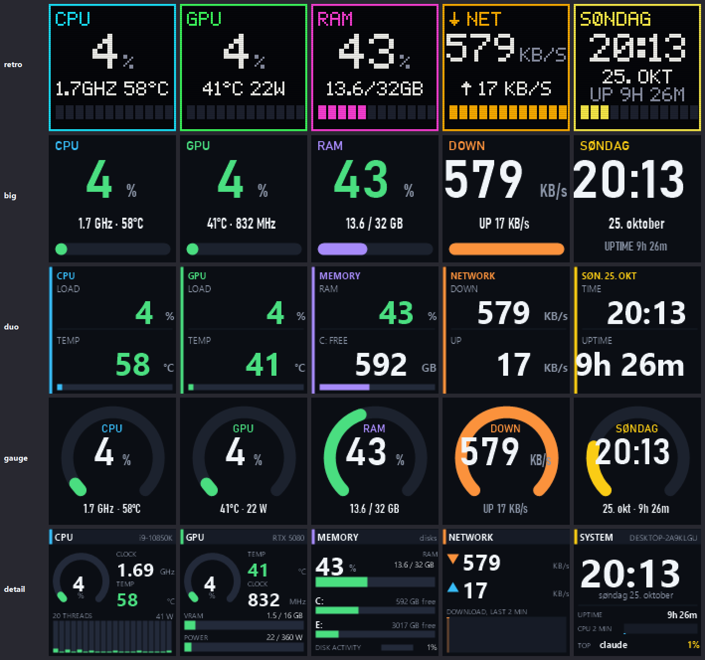

# Divoom Times Gate PC monitor

Turn a [Divoom Times Gate](https://divoom.com/products/time-gate) (five 128×128 LCDs) into a live status display for your Windows PC: CPU load/clock/temperature, GPU load/temperature/power, RAM and disks, network throughput, and a clock. Pure PowerShell, no cloud, talks to the device directly over your LAN.



Five styles are included (`retro` is the default): `retro` (pixel font, VU bars, scanlines), `big`, `duo`, `gauge`, `detail`.

## Requirements

- Windows 10/11 with Windows PowerShell 5.1 (built in). Fonts used: Segoe UI and Bahnschrift, both ship with Windows.
- A Times Gate on the same network. Find its IP in your router or the Divoom app.
- NVIDIA GPU for the GPU tile (uses `nvidia-smi`, installed with the driver). Other GPUs show `--`.
- [LibreHardwareMonitor](https://github.com/LibreHardwareMonitor/LibreHardwareMonitor) for CPU temperature and power (optional; without it the CPU tile shows `--` for temperature). Install with `winget install LibreHardwareMonitor.LibreHardwareMonitor`, enable **Options → Remote Web Server** (port 8085) and run it as administrator.

## Quick start

```powershell
# Try it: push the dashboard to the device until you press Ctrl+C
powershell -ExecutionPolicy Bypass -File .\pcmon.ps1 -Ip 192.168.1.50

# See what the tiles look like without a device: writes preview\<style>\tile0..4.png and preview\styles.png
powershell -ExecutionPolicy Bypass -File .\pcmon.ps1 -Preview

# Other styles, or cycle through all of them (20 s each)
powershell -ExecutionPolicy Bypass -File .\pcmon.ps1 -Style big
powershell -ExecutionPolicy Bypass -File .\pcmon.ps1 -Demo
```

Set your device's IP as the default by editing the `$Ip` parameter at the top of `pcmon.ps1`.

### Start automatically at logon

`install-autostart.ps1` (run from an **elevated** PowerShell) registers two scheduled tasks: one that starts LibreHardwareMonitor with admin rights and no UAC prompt, and one that runs `pcmon.ps1` invisibly 20 s after logon, restarting it if it crashes.

```powershell
.\install-autostart.ps1            # install and start
.\install-autostart.ps1 -Uninstall # remove both tasks
Stop-ScheduledTask 'Divoom pcmon'  # pause the dashboard (e.g. before running pcmon.ps1 by hand)
Start-ScheduledTask 'Divoom pcmon'
```

## Useful parameters

| Parameter | Default | Meaning |
|---|---|---|
| `-Ip` | `192.168.2.169` | Device address |
| `-Style` | `retro` | `retro`, `big`, `duo`, `gauge` or `detail` |
| `-Layout` | `0,1,2,3,4` | Which tile goes on which screen, left to right (0 CPU, 1 GPU, 2 RAM/disk, 3 network, 4 clock) |
| `-LhmUrl` | `http://localhost:8085/data.json` | LibreHardwareMonitor web server |
| `-Log` | | Print every picture sent with size, JPEG quality and round-trip time |
| `-Preview` | | Render all styles to `preview\` and exit |
| `-Demo` | | Cycle through all styles |

Date strings use Norwegian (`nb-NO`); change `$NbNo` in `pcmon.ps1` for another language.

## How the device API works (and its quirks)

Everything in `NOTES.md` was found by probing a real Times Gate; Divoom publishes no API documentation for it. The short version:

- Endpoint: `POST http://<ip>:9000/divoom_api` with a JSON body (not port 80 `/post` as for the Pixoo).
- Pictures: `Channel/SetIndex` with `SelectIndex: 3` first, then `Draw/SendHttpGif` with `LcdArray` selecting the screen(s) and `PicData` as a **base64 JPEG**. Raw RGB (the Pixoo format) only shows a loading spinner.
- Every picture needs a new `PicID`; re-sending an ID is ignored.
- **JPEG size must stay around 5–6.5 KB** or the screen flashes a loading spinner. `pcmon.ps1` lowers the JPEG quality until the picture fits and pads smaller ones with a comment segment.
- The device needs ~0.5–1 s per picture; `pcmon.ps1` sends the fast-changing tiles every cycle and the memory and clock tiles every 10 s.

`divoom.ps1` is a small test tool for sending your own images or random test pictures to any screen.

## Files

- `pcmon.ps1` – the dashboard
- `install-autostart.ps1` – scheduled-task installer
- `divoom.ps1` – send test pictures / your own images
- `NOTES.md` – everything learned about the device's HTTP API
- `preview/` – rendered examples of every style

## License

MIT
